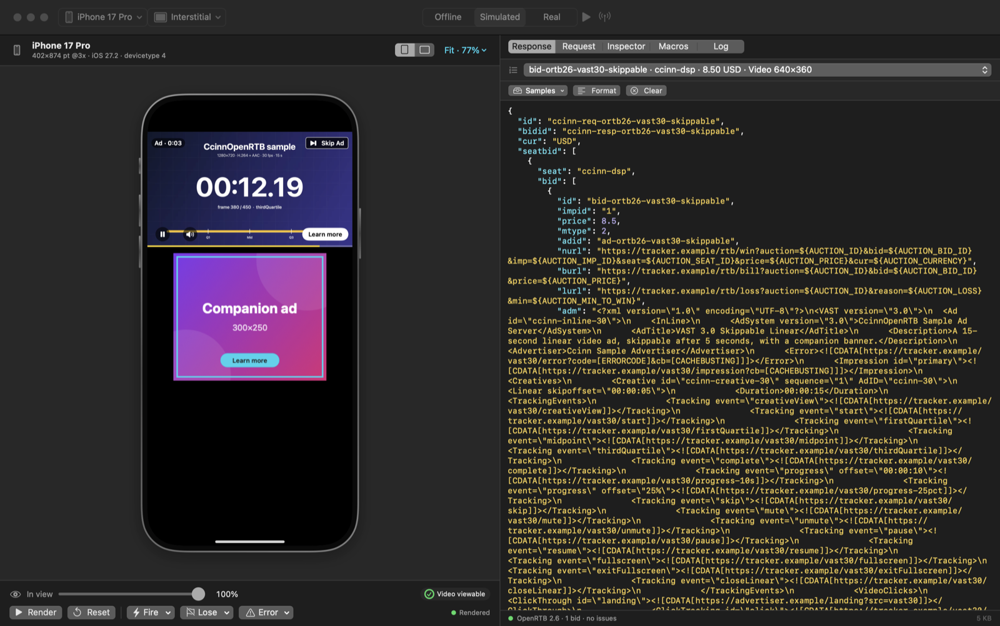
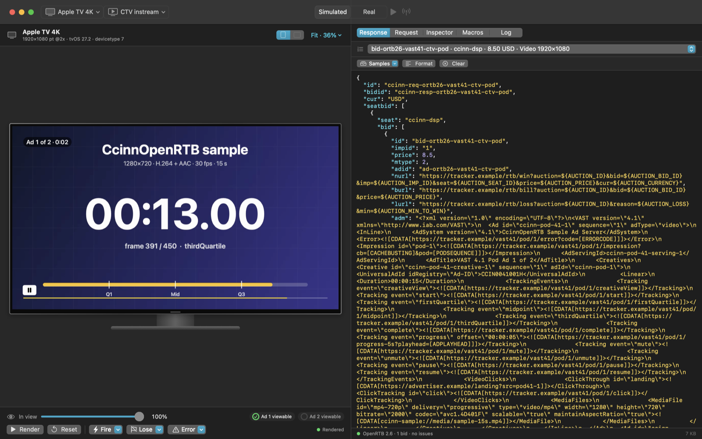
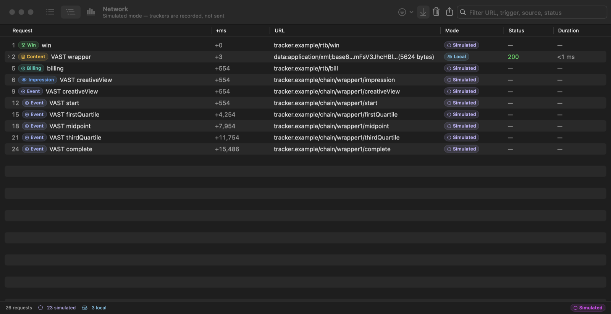

<p align="center">
  
</p>

<h1 align="center">CcinnOpenRTB</h1>

<p align="center">
  <b>A native OpenRTB ad rendering and tracking simulator for macOS.</b><br>
  Paste a bid response, see the ad on a simulated phone, foldable, tablet or TV, and watch every tracker in a real-time network view. No tracker is sent unless you ask for it.
</p>

<p align="center">
  <a href="https://github.com/whiteCcinn/ccinnopenrtb/actions/workflows/ci.yml"></a>
  <a href="https://github.com/whiteCcinn/ccinnopenrtb/releases/latest"></a>
  
  
  
  
  <a href="LICENSE"></a>
</p>

<p align="center">
  English · <a href="README.zh-CN.md">简体中文</a>
</p>

<p align="center">
  
</p>
<p align="center">
  
  
</p>

## Why CcinnOpenRTB?

Exchange, SSP, DSP and SDK engineers keep asking the same question: *what does this bid response actually render on a device, and which trackers fire, in what order?* Answering it usually means one of these:

- reading `adm` blobs by hand,
- pasting VAST into a web validator that knows nothing about OpenRTB,
- building a real SDK and pointing it at a test exchange.

CcinnOpenRTB answers it on your Mac. Paste an OpenRTB bid response, a bare `adm` or a VAST tag URL. The ad renders in a device frame the way an SDK or player would show it. Every win notice, impression, viewability event, VAST event, click and error appears in the Network window, with expanded macros, timing and the event that caused it.

By default no tracker is sent, and Offline loads nothing at all: see [Offline, Simulated and Real](#offline-simulated-and-real). The app is native SwiftUI/AppKit, with no third-party dependencies, no bundled runtime and no telemetry.

## Offline, Simulated and Real

Every session starts in **Simulated** mode. **Simulated mode never sends trackers or notices; it does load the ad's content (VAST, images, video) from the URLs in the markup, which the ad server can see. Choose Offline to load nothing.** That trackers are never sent is enforced in the structure of the code, not only by tests: the HTTP transport can only be called with a send permit, and no permit exists for a tracker in Simulated or Offline mode. Switch to **Real** only when you want trackers to reach their servers.

The toolbar shows **Offline · Simulated · Real**, and each segment's tooltip says what that mode loads and sends. The Simulator menu has the same choice. A window remembers Offline; it never remembers Real.

| | Offline | Simulated (default) | Real |
|---|---|---|---|
| **Trackers and notices**: win `nurl`, billing `burl`, loss `lurl`, impressions, viewability, VAST events, clicks, errors | Recorded, **never sent** | Recorded, **never sent** | Sent with the simulated device's User-Agent. Status, timing, the headers actually sent and size are recorded. |
| **Tracker redirects** | Nothing is sent, so there are none | Nothing is sent, so there are none | Not followed automatically. The app follows each hop itself and records it as a child entry (at most 10 hops; loops are detected). |
| **Script trackers**: Native `jstracker`, `eventtrackers` and AdCOM events with method 2 | Recorded, not run | Recorded, not run | Recorded, then each run once in its own hidden web view; the loads it makes are its child entries |
| **The HTML creative's own network**: scripts, pixels, `fetch`, XHR, beacons | Blocked | Blocked by a WebKit content rule list; nothing lifts the block. Loads through elements (`img`, `script`, `iframe`, `link`, media, `object`, `embed`), `fetch`, XHR, `sendBeacon`, WebSocket and WebRTC appear as `blocked`. Loads from CSS (`url()`, fonts, `@import`), `EventSource`, `<a ping>` and workers are blocked without an entry. | Not blocked |
| **The ad's content**: VAST tag and wrapper fetches, images, media, Native `assetsurl`, markup by reference (AdCOM `display.curl`) | **Not loaded.** Recorded as `offline`; the ad shows what is missing | Fetched from the URLs in the markup | Fetched from the URLs in the markup |
| **Markup delivered by the win notice** (a bid with `nurl` and no `adm`) | Not fetched | Not fetched: the win notice is a tracker. The ad slot says so; switching to Real fetches it | The `nurl` response body is the markup, and the URLs inside it hang under that request |
| **`data:` URLs and built-in sample media** (`ccinn-sample://`) | Decoded or generated on the Mac | Decoded or generated on the Mac | Decoded or generated on the Mac |
| **Click-throughs** | Recorded as navigation, never opened | Recorded as navigation, never opened | Recorded. Opened only when **Settings ▸ Network ▸ Open click-throughs in browser in Real mode** is on (off by default), in the default web browser — the app that opens web links, never an app that claims the link. |
| **A bid request you send from the [Client](#the-client-tab) tab** | Recorded as `offline`, **not sent** | Sent to the URL you entered, exactly as you typed it | Sent to the URL you entered, exactly as you typed it |
| **A cookie-sync run from the [Sync](#the-sync-tab) tab** | Recorded as `offline`, **not sent** | Sent with the window's in-memory cookie jar, every redirect followed | Sent with the window's in-memory cookie jar, every redirect followed |
| **A Prebid.js auction from the [Prebid](#the-prebid-tab) tab** | Prebid.js runs if that version was loaded before (it is cached); the bidders' requests are recorded as `offline`, **not sent** | Prebid.js fetched from jsDelivr once per version; the bidders' requests sent to their endpoints, without cookies | Same as Simulated |

- Switching to Real asks for confirmation. The sheet lists the tracker hosts of the selected bid, says which requests cannot be listed in advance (script trackers, a creative's own scripts), lists the content hosts the render already contacted, and warns when win, billing or loss notices of the same auction were already sent in this session: sending again may double-count at the DSP. Cancelling keeps the current mode.
- The confirmation lasts for the current session only, and describes exactly one bid, device and placement: if any of them changes while it is shown, it asks again.
- Leaving Real, rendering again, **Reset** and **Lose** take effect at once: trackers in flight are cancelled (a hop on the wire is finished as cancelled, one not sent yet is recorded as not sent), every Real-mode web view (script trackers, an HTML or iframe companion) stops, and a render still being prepared in Real mode is stopped, so no later wrapper hop goes out with Real-mode values.
- Rendering the same bid again replays its auction: every play after the first is numbered **replay N** in the lifecycle log and in the source of every Network entry it causes (`bid 1.1 · replay 2 › nurl`). In Real mode a replay sends the auction's notices again.
- **The pasted request's personal data stays on the Mac until you confirm Real mode.** In Simulated and Offline mode, nothing derived from it leaves the Mac (a bid request you send yourself from the Client tab goes, as you typed it, to the URL you entered; Offline sends nothing): when the player fetches a VAST tag or wrapper, `[IFA]`, `[IFATYPE]`, `[DEVICEIP]`, `[LATLONG]`, `[GDPRCONSENT]`, `[GPPSTRING]` and `[GPPSECTIONID]` are sent as `-1`, and `[DEVICEUA]` as the simulated device's User-Agent. Publisher-context macros (`[LIMITADTRACKING]`, `[DOMAIN]`, `[PAGEURL]`, `[APPBUNDLE]`, `[TRANSACTIONID]`) are still filled from the request: they describe the placement, not the user. Real mode fills every macro with the pasted request's values, device identifiers, location and consent strings included, as a device would; use it with test requests or with consent.
- Every tracker and content request carries the simulated device's User-Agent and an explicit `Accept-Language`, and no cookies or credentials; authentication challenges are refused. Video and audio are fetched by the app, never by the media player's own networking.
- The mode is shown in the toolbar and on every entry in the Network window.
- CTV devices never navigate, in any mode.
- Native 1.2 `dcourl` (dynamic creative, beta in the spec) is logged as unsupported and never fetched.
- Apart from the requests above, the only thing that leaves your Mac is the once-a-day update check against GitHub, which you can turn off.
- A bid request from the Client tab is not a tracker: leaving Real, rendering again, Reset and Lose do not cancel it; going Offline and **Clear** in the Network window do.

> [!WARNING]
> Real mode sends real trackers. To the receiving server they look like traffic from the simulated device, so they can inflate the numbers of a live campaign. Use Real mode with your own test endpoints, or with the agreement of whoever owns the trackers.

## Features

- **Send a bid request, Postman-style.** The [Client](#the-client-tab) tab sends the request you type to an endpoint, shows the response, and renders it on the device with the format and placement the request and response imply. Save requests with their responses and open them again later.
- **Run official Prebid.js.** The [Prebid](#the-prebid-tab) tab hosts any Prebid.js release on a publisher page the way the device's browser would show it, with the bid adapters you pick: their requests go to the real endpoints through the window's network gate, and their bids render on the device.
- **Debug cookie mapping.** The [Sync](#the-sync-tab) tab runs a user-sync chain as the device's browser would — WebKit blocks third-party cookies on iPhone, Chrome needs `SameSite=None; Secure` — with every hop's cookies, the ids passed along and the placeholders left unsubstituted.
- **Paste what an exchange returns.** An OpenRTB 2.x or 3.0 bid response, a bare `adm` (HTML, Native JSON or VAST XML) or a VAST tag URL. The input type and version are detected automatically. Parsing is lenient: wrong types become validation issues and unknown fields are kept. A no-bid response shows "No bid" with the `nbr` reason named. Markup or a response copied out of a JSON string — a log line, an `adm` value: `<VAST version=\"3.0\">`, Go's `\u003cVAST…` — is read unescaped, and the Issues list says so.
- **Format any markup.** **Format** (⇧⌘F) in the Response, Request and Client editors pretty-prints JSON (OpenRTB, Native), VAST XML and banner HTML, and unescapes text copied out of a JSON string first (escaped twice, too). Only whitespace changes:
  - JSON keeps key order, number spelling and escapes.
  - VAST gets one element per line; an element's text and CDATA (URLs, macros) are kept as typed, so every value reads the same.
  - HTML gets line breaks only where the browser ignores whitespace with the default styles — around block elements and `<br>`, in `<head>`, before the first content of a line — so inline runs such as `<a></a>` stay on one line and the creative renders as before. `script` (a legacy `<!-- document.write('<script…></script>') -->` too), `style`, `textarea` and `pre` are kept as typed; an element's own `style` counts (`display: inline…` or `none`, `white-space: pre…`), and an element that is not rendered (`hidden`, `template`, a closed `dialog`) never breaks a line. Indentation stops deepening after 32 levels. (A stylesheet rule that makes a `div` inline-block can still show a new line break as a space; ⌘Z undoes Format.)

  The Inspector's **Markup** view shows the selected bid's markup formatted, also as the device receives it once the exchange's macros are substituted, with **Copy**; the Network window and the Client tab show JSON, XML and HTML bodies formatted too.
- **The exchange's part, too.** Like an exchange (OpenRTB 2.6 §4.4), the simulator substitutes its `${AUCTION_*}` / `${OPENRTB_*}` macros in the bid's inline `adm` — HTML, Native JSON or VAST XML — before the device sees it; VAST `[MACROS]` stay for the player and are filled when each tracker fires. Markup the DSP returns after the win (`nurl` response, `display.curl`) is used as delivered.
- **Pick the bid.** Every bid across all seats is listed with its format. Optionally paste the bid request too: it resolves Native asset types, the impression size and placement, and request-side macros. The bid's impression names its ad unit: `imp.rwdd` (or `imp.ext.is_rewarded_inventory`, `imp.ext.prebid.is_rewarded_inventory`; AdCOM `placement.reward`) makes it rewarded, `imp.instl` or `video.plcmt` 3 (AdCOM `display.instl`) interstitial.
- **Render it as a device would**
  - HTML and rich media in a sandboxed web view with an MRAID 3.0 bridge. Bridge calls are logged. Clicks and navigations are recorded instead of leaving the simulator.
  - Touch, as on the device. On phones, foldables and tablets the mouse is a finger for HTML creatives and HTML companions, in every frame: they see `TouchEvent`, `ontouchstart`, `navigator.maxTouchPoints` 5 and a phone's answers to `matchMedia('(pointer: coarse)')` and `(hover: none)`, so they take their mobile path.
    - A click is a tap: `pointerdown` (`pointerType: "touch"`), `touchstart`, `pointerup`, `touchend`, then `mousemove`, `mousedown`, `mouseup` and the click, in a phone's order. A creative that cancels the tap (`preventDefault()` in `touchstart` or `touchend`) gets no click, as on a phone.
    - A drag is a swipe: `touchmove` events on the element the finger went down on, and no click. It scrolls what a finger would scroll (an `overflow` carousel, a long page; CSS `touch-action` respected) unless the creative cancels it, and on release it coasts and settles on the carousel's scroll-snap point.
    - There is no hover, text selection or drag-and-drop. Events a creative dispatches itself are left alone.
    - Each gesture is a line in the log: "Tap at 120, 340", "Swipe left 180 pt in 220 ms", with what the creative did with it. A landing page opened when a swipe's finger lifts counts as a click, however long the swipe took.
    - Not emulated: two-finger gestures, long press, and CSS `@media (hover)` / `:hover` rules in stylesheets, which still see the Mac's mouse. The synthetic events have `isTrusted: false`; the click is the real one. The wheel and trackpad scroll the feed as before, and right-click still offers Inspect Element.
  - Image banners (OpenRTB 3.0 `display.banner`).
  - Native 1.0, 1.1 and 1.2 in in-feed, content-stream and app-install layouts, with the privacy link and per-asset clicks.
  - VAST video and audio: skip (from `skipoffset`), mute, pause, countdown, click-through, progress bar, companions (shown from the ad's first frame) or an end card, industry icons such as AdChoices, ad pods in `sequence` order, and wrapper chains up to 5 levels. An ad whose required companions (`CompanionAds@required`) cannot be shown — on CTV, none can — is not played (error 602), and a wrapper's `BlockedAdCategories` reject a matching ad (error 205).
  - Placements: inline banner, in-feed, interstitial, rewarded and CTV instream. The bid picks a sensible one (a rewarded or interstitial impression in the request first, then a 320×480 bid is an interstitial, Native is in-feed, video full screen; a CTV device plays instream); you can change it. Full-screen ads have a close control with a 44 pt (Apple) or 50 pt (Android) hit area; a non-skippable video offers it when it ends.
  - CTV: full-screen pod playback ("Ad 1 of 2"), remote-style focus with the arrow keys, Return, Escape and Space, and no click-through.
- **Devices.** 28 devices (the iPhone 18 Pro by default): iPhones from SE to 18 Pro Max, Android phones, foldables including the iPhone Duo (folded or unfolded), the Surface Duo (one screen or spanned across the hinge), iPads and four CTV platforms, in portrait or landscape, each with its own system chrome and mock app. See [Devices](#devices).
- **Tracking at the right moment.** Trackers fire when a real SDK or player would fire them, with OpenRTB, AdCOM and VAST macros expanded and unknown macros reported. A **Viewability** slider scrolls the ad in and out of view and drives the MRC rules: 50% for 1 s for display, 50% for 2 s for video. **Fire** buttons trigger events by hand. See [Tracking and macros](#tracking-and-macros).
- **Network window.** Every request in real time as a table, a relationship tree and a waterfall, with details, filters, HAR export and copy as curl. See [The Network window](#the-network-window).
- **Validation.** The inspector checks the response against the detected OpenRTB, Native and VAST versions: required fields, wrong types, invalid URLs, non-HTTPS trackers when the request requires secure creatives, an `adm` the DSP escaped twice (`openrtb.bid.adm.escaped`; a device could not read it, so it is rendered as received), missing playable media, wrapper depth, and fields that belong to another version. Each issue has a severity, a code, a message and a location (a JSON pointer or a VAST element path).
- **Samples that work offline.** Built-in samples cover every supported format and version: HTML and MRAID, Native 1.0–1.2, VAST 2.0–4.2 (a wrapper chain, a CTV pod and an audio ad included), OpenRTB 3.0 and a no-bid. Sample media is generated on the Mac on first use and cached under `~/Library/Caches`: a 15 s 1280×720 H.264 MP4 with a timecode, a 15 s AAC tone, and PNG images.

## The Client tab

A request composer in the right panel of every window, for sending a bid request to an exchange, SSP or DSP endpoint and seeing what comes back on the device.

- **Compose.** Method (**POST**, or **GET** for an endpoint that takes its query in the URL), the endpoint URL, headers and the body you type. New requests carry `Content-Type: application/json` and `x-openrtb-version: 2.6`; turn headers off, edit them or add your own. **Format** (⇧⌘F) pretty-prints the body (JSON, XML or HTML) without reordering it, and unescapes a body copied out of a JSON string.
- **Send** (⌘↩) through the window's network gate, with the simulated device's User-Agent (the iPhone 18 Pro unless you pick another device) and an explicit `Accept-Language`, unless you set those headers yourself. The endpoint may be plain `http://` or `https://`. **Cancel** (⌘.) stops it. A request that cannot be sent says why: a URL that is not http(s), a header name that is not a token, a value with a line break, a header set twice. A body that is not JSON is sent as typed, with a warning.
- **The response**: status, time, size, headers, and the body, pretty-printed when it is JSON, XML (a VAST answer) or HTML. Any status is shown, error bodies included.
- **On the device.** A 2xx response with a body goes into the **Response** editor and the request into **Request**, so the simulator takes the bid's format from both (`mtype`, the impression's media types, the markup) and its placement from the request (rewarded, interstitial, in-feed …). Simulated and Offline windows render it at once; in Real mode the editors are filled and the device waits for **Render**, since rendering sends the bid's trackers. A 204 or an empty body is no bid and leaves the simulator alone. The tab says what the simulator made of it: "OpenRTB 2.6 · 1 bid · Video · Rewarded · iPhone 18 Pro".
- **Saved requests.** **Save** (⌘S) keeps the request with its last response and the device it was sent as; **Saved** lists them (newest first, searchable) in every window. Open one to send it again, or **Render** its saved response on its device without sending anything. Duplicate and delete from the list. A click opens a request; ⌘-click and ⇧-click select several (then **Select All**, or ⌘A), and **Delete…** in the footer, the context menu or the Delete key removes them all after one confirmation — only the requests the search lists, never one it hides. **Groups** sort them: right-click › **Move to Group** (or **Move to** in the footer for the selection) puts requests in an existing group or a **New Group…**, and each group is a section you can fold (remembered) with **Select All in Group**, **Rename Group…** and **Remove Group…** in its ⋯ menu — removing a group keeps its requests. A request is in one group at most; names ignore case ("G24" and "g24" are one group); the search matches group names, and Save, Save as New, Duplicate, export and import keep the group. Each is a JSON file in `~/Library/Application Support/CcinnOpenRTB/Requests/`, readable only by your account; it holds your headers (credentials included) and the request's personal data.
- **Move them to another Mac.** **Export All…** (in **Saved**, or the ⋯ menu) writes every saved request with its last response to one JSON file; on the other Mac, **Import…** reads it in one go. Requests are merged by id: a copy here is replaced only by a newer one, so importing twice changes nothing. A damaged entry is skipped and counted, never fatal. The export holds your headers (credentials included) and the requests' personal data, and is written readable only by your account: keep it private.
- **Copy as curl** (in the ⋯ menu) copies exactly what Send would put on the wire (with `--location --max-redirs 10` when the request follows all redirects).
- **Redirects.** Each request has its own setting, next to **Body** and **Headers** (Settings ▸ Network ▸ Client sets it for new requests):
  - **Follow redirects within the origin** (the default): hops within the endpoint's scheme, host and port are followed; a redirect anywhere else (another host, scheme or port, http↔https included) is the answer, so nothing you typed — custom credentials such as `X-Api-Key`, the request's personal data — goes where you did not point. A **Follow to ‹host› and Send** button sends that same request again following every redirect, for that send only (the request's setting stays as it is), and opens on the chain; it is offered only while the request is unchanged and only when following can go further.
  - **Follow all redirects**, as `curl -L` does: every hop, at most 10, loops detected. `Authorization`, `Proxy-Authorization` and `Cookie` stay behind on a hop to another origin; your other headers and, on 307 and 308, the POST and its body go along. A downgrade to http is followed and flagged.
  - **Don't follow redirects**: the first 3xx is the answer.

  On every hop, 307 and 308 repeat the method and body; 303 (and 301 or 302 after a POST) continue as a GET without the body.
- **The redirect chain.** The response's **Redirects** tab lists every request of the chain in order: method, URL, status, the `Location` it pointed to, time, the body it carried, what changed on the way (method, body, headers left behind, a downgrade to http) and why the chain ended (not followed, a loop, more than 10 hops). A loop, too many hops or a target that is not http(s) is an answer you can inspect, not an error. The request is a **Bid request** entry in the Network window, each hop a child entry with the same notes.

## The Sync tab

Cookie mapping (user sync) as the device's browser would run it: an SSP's sync endpoint redirects to a partner's pixel, the partner redirects back to the SSP's `setuid` URL with its user id, and each side keeps a cookie. When a match rate drops, nothing errors — this tab shows why.

- **Run** (⌘↩) a start URL — the SSP's sync endpoint or a partner's pixel — on a **page** (the publisher URL: its site decides which cookies are third party, its origin is the `Referer`). The request goes out as an image pixel would, every redirect is followed, and the window's **cookie jar** is read before and filled after every hop.
- **The browser** follows the simulated device (Safari on iPhone and iPad, Chrome on Android, a TV app on CTV), or pick one; it decides the third-party cookie policy *and* the User-Agent the partners see:
  - **Safari** and **iOS app web view** — WebKit blocks third-party cookies: the same chain that works in Chrome stores nothing here, and the tab says so.
  - **Chrome on Android** — `SameSite=None; Secure` required, a cookie without `SameSite` is Lax (not stored or sent cross-site), `Partitioned` cookies (CHIPS) kept per top-level site.
  - **Android app WebView** — third-party cookies are off unless the app turns on `acceptThirdPartyCookies`.
  - **Firefox** — Total Cookie Protection: kept per top-level site; cookies set first party are not visible.
  - **TV app** — no browser cookie jar shared with the web.

  A jar belongs to one browser: choosing another starts an empty one.
- **Consent macros** in the start URL are filled from the values you give: `${GDPR}`, `${GDPR_CONSENT_<id>}`, `${GDPR_PD}`, `${ADDTL_CONSENT}`, `${US_PRIVACY}`, `${GPP_STRING_<id>}`, `${GPP_SID}` (IAB TCF "URL-based services" and GPP URL macros, URL-encoded).
- **Every hop** shows the cookies sent, the ones withheld and why (`SameSite=Lax` on a cross-site request, third-party blocked, `Secure` over http, kept for another site), and what became of each `Set-Cookie`: stored with its attributes, or rejected with the reason (`SameSite=None` without `Secure`, Lax by default from a cross-site response, a public-suffix or mismatched `Domain`, `__Secure-` / `__Host-` rules, `Secure` from http, too large).
- **Verdicts**: the ids passed along (`Mapped: dsp → uid=abc123, passed to ssp.example/setuid`), "no id" answers (`uid=0`, `undefined` …: no cookie for this user, or an opt-out), placeholders a partner left unsubstituted in its own URL (`$UID`, `${UID}`, `[UID]`, `{uid}`, `{{.UID}}` — an id placeholder loses the match; a URL passed along, `redir=…` or AppNexus-style `getuid?<url>`, is the next party's template and is not flagged), cookies blocked by the browser, where the chain stopped, and — for a run that failed — what happened before it failed.
- The jar follows the browsers' storage model: a host-only and a `Domain` cookie of one name are two cookies (both sent), an http response cannot replace a `Secure` cookie, expiry is capped at 400 days, at most 180 cookies per domain, and a `Set-Cookie` with a control character is ignored. The `Referer` is the page's origin, and is dropped on a downgrade to http.
- **Run Again** reuses the jar, so a second run shows whether the mapping is stable; **Cookie Jar** lists the cookies by domain; **Clear Cookies** starts over. The jar lives in the window's memory only: it is never the Mac's browser cookies and is never written to disk.
- Sync requests are **User sync** entries in the Network window, each hop with its cookies. They are sent in Simulated and Real mode (you pressed Run), recorded and not sent when Offline.

Not modelled: a real browser's other heuristics (ITP's classification, storage-access prompts), and scripts in iframe syncs.

## The Prebid tab

Official [Prebid.js](https://prebid.org) on a simulated publisher page: choose a release and the bidders, send their requests to the real endpoints, and see the bids on the device.

- **Version.** Every release on npm; the default is the newest one at least two weeks old (a brand-new release can carry fresh regressions, or a compromised publish). Its files — the official loader `dist/bundle.js?modules=…`, its manifest and chunks — are fetched from jsDelivr through the window's network gate and cached in `~/Library/Caches/CcinnOpenRTB/prebid`, so a release once loaded also runs Offline (its bidders' requests are then recorded, not sent).
- **Bidders.** **Add Bidder** searches every bid adapter of that release, aliases included, with their IAB GVL ids (from the release's `metadata/modules.json`); each bidder's params are JSON. The page loads exactly the adapters of the bidders you added, plus the consent modules you use. A bidder the release does not have, params that are not a JSON object, or an ad unit without a code, a size or a bidder are flagged before anything loads.
- **Ad units**: code (the div id), banner, video (outstream) or native, and sizes. The tab starts with Prebid's public AppNexus test placement (`placementId` 13144370).
- **Consent (static)**: TCF (GDPR applies or not, the TC string; purposes 1–11 and the bidders' vendors are consented), US Privacy and GPP, set with `cmpApi: 'static'` so no CMP is looked up.
- **Run Auction** (⌘↩) loads the page and calls `pbjs.requestBids` with your timeout; **Stop** (⌘.) unloads it.
- **The bidders see a page on the device.** The page is at your page URL (`https://news.example/article` by default): `location`, Prebid's referer detection, `pageUrl` and a secure context all say so, and nothing is fetched for it. Its requests are built by WebKit's own `Request` (method, headers, body and its `Content-Type` as Safari sends them) and carry the device browser's User-Agent, `Accept-Language`, `Origin`, `Referer` (the page's origin, under the default `strict-origin-when-cross-origin` policy) and `Sec-Fetch-*`; Chrome on Android adds its client hints (`Sec-CH-UA*`, `navigator.userAgentData`, which Prebid reads into `device.sua`). Its scripts read the device's screen (402×874 at @3x for the iPhone 18 Pro), viewport, pixel ratio, `navigator.platform`, `navigator.vendor` and touch points. Prebid runs with its production configuration (debug off), so adapters behave as on a live site.
- **The browser's rules.** A cross-origin request that needs one gets its CORS preflight (`OPTIONS`, in the Network window); a bidder whose answer does not allow the page's origin — no `Access-Control-Allow-Origin`, `*` on a credentialed request (Prebid's `withCredentials`), no `Access-Control-Allow-Credentials: true` — loses it as it would in Safari, and the **Log** says why. http from the https page is mixed content and is refused (the Mac's own `localhost` aside, for a local test bidder). The page reads only the response headers the bidder exposes.
- **Results.** **Bids** lists every bid: bidder, CPM, size, format and ad unit. **Render** shows one on the device as an OpenRTB 2.6 bid of that bidder (`${AUCTION_PRICE}` filled with its CPM, a VAST tag wrapped, Native from its ORTB response), with the simulator's placements and trackers. **Timeline** lists Prebid's events with their times: each bidder's request, response, no-bid, timeout and error. **Syncs** lists the image and iframe user syncs the adapters asked for; **Use in Sync Tab** puts one in the [Sync](#the-sync-tab) tab, on the same page, to run with its cookie jar. **Log** shows Prebid's warnings and errors: invalid params, rejected bids, consent.
- Each bidder's request is a **Bid request** entry in the Network window (source `prebid › page`) with its headers and body, sent in Simulated and Real mode (you pressed Run), recorded and not sent when Offline. Prebid's own files are **Content** entries.

**What the page can reach.** Everything goes through the network gate. `fetch`, XHR and `sendBeacon` are sent by the app. The only scripts that load are Prebid's own files of the chosen release, handed to the page from the cache as same-origin `blob:` scripts whose `integrity` WebKit still checks; any other script URL is refused and logged. User-sync images and iframes are listed, not loaded. WebRTC and WebTransport (their own sockets) are removed and workers refused, in every frame; following a link does nothing. A Content-Security-Policy and a WebKit content rule list block every other load (stylesheets, images in markup, media, WebSocket, forms …), and the page cannot navigate away. Every auction is a fresh visit (website data is emptied first; `document.cookie` lives in memory) and its requests carry no cookies — Safari, the iPhone's browser, sends no third-party cookies anyway; to see a mapped id, run the sync in the Sync tab.

Not modelled: rendering the winner inside the page (`pbjs.renderAd`, Prebid Universal Creative), ad server targeting, user ID, RTD and analytics modules, Prebid Server (`s2sConfig`), the preflight cache (each request that needs a preflight gets one), and how `Origin` and `Referer` change after a cross-origin redirect.

## The Network window

Open it with **Window ▸ Network** (**⌥⌘N**). There is one Network window; it shows the session of the focused main window.

- **List**, updated in real time: sequence, relative time (+ms), category, trigger, host and path, mode, status and duration.
- **Tree** of relationships. A request's parent is the request that delivered the document its URL is in: each VAST tracker, media file and companion (its image, an HTML or iframe companion's own loads and navigation) hangs under the wrapper or inline hop that delivered it; the trackers, clicks, navigations and creative loads of markup delivered by `nurl` or `display.curl` hang under that request; URLs written in the bid response itself (`nurl`, `burl`, `lurl`, AdCOM events, the AdCOM banner link) are roots. Redirect hops hang under their tracker. A tracker never parents a navigation: the requests of one click share its trigger.
- **Waterfall** timeline.
- **Details**: the URL template next to the expanded URL with macros highlighted, replaced and unknown macros, query parameters, request and response headers, the redirect chain, and a preview of the request and response bodies — JSON, VAST XML and HTML **Formatted** (unescaped when they hold a JSON string) or **Raw**.
- **Filters** by category, mode and text. **Follow tail** keeps the newest entry in view. **Clear** empties the session's list.
- **Content** entries carry a CONTENT badge, so what the app loads to render the ad never looks like a tracker. A VAST tag or wrapper URL shows the URI as written next to the URL actually requested (the player expands VAST macros in it). The request headers are the ones actually sent.
- **Export HAR 1.2.** Entries carry custom `_ccinn` fields: `sequence`, `category`, `trigger`, `source`, `mode`, `delivery`, `parent`, `template` and `macros`. A bid request's body is its `postData`.
- **Copy URL** and **Copy as curl**. The curl command is shell-quoted and uses `--globoff`, so VAST `[MACROS]` are not read as curl globs. A bid request's body goes in `--data-raw` (never `--data-binary` or `-d`, which would read a body starting with `@` as a file to upload), with its line breaks; other control characters are written as JSON `\u00XX` escapes.
- A session keeps at most 10,000 entries. The oldest are dropped first.

| Category | What it is |
|---|---|
| `win` | Win notice: `nurl` (2.x) or `purl` (3.0) |
| `billing` | Billing notice: `burl` |
| `loss` | Loss notice: `lurl` |
| `impression` | VAST `Impression`, Native `imptrackers` and impression event trackers, AdCOM impression events |
| `viewability` | Native `eventtrackers` 2–4, AdCOM events 3–5, VAST `ViewableImpression` |
| `event` | VAST tracking events: `creativeView`, `start`, quartiles, `complete`, `progress`, `mute`, `pause`, `skip`, … |
| `click` | Native `clicktrackers`, VAST `ClickTracking` and `CompanionClickTracking` |
| `navigation` | A click-through target: Native `link.url`, VAST `ClickThrough`, `mraid.open`, `window.open`, links |
| `error` | VAST `Error` URLs with `[ERRORCODE]` |
| `verification` | VAST `AdVerifications` tracking, such as `verificationNotExecuted` |
| `content` | What the app fetches to render the ad: VAST wrappers and tags, images, media, Native `assetsurl`, `display.curl` markup; Prebid.js's files and its version list |
| `creative` | Whatever the HTML creative loads, or tries to load |
| `bidRequest` | A bid request you sent from the Client tab, or one a Prebid.js adapter sent from the Prebid tab, with its method, headers and body |
| `userSync` | A cookie-sync request from the Sync tab, with the cookies sent and set on each hop |

In HAR exports the mode is `_ccinn.delivery`: `simulated`, `network` (Sent), `blocked`, `offline`, `local`, `renderer` or `browser`; `_ccinn.mode` is the session's tracking mode.

| Mode | Meaning |
|---|---|
| Simulated | Recorded, not sent |
| Sent | Sent by the app: a tracker in Real mode, or a content fetch |
| Blocked | The creative tried to load it, and the sandbox blocked it |
| Offline | Content the session did not load because it is Offline |
| Local | Served on the Mac: a `data:` URL or built-in sample media |
| Renderer | Loaded by the web view itself: a Real-mode creative's own loads, injected script trackers |
| Browser | A click-through opened in the default browser |

## Tracking and macros

| When | What fires |
|---|---|
| Win | `nurl` (2.x) or `purl` (3.0) |
| Render | `burl`, AdCOM event types 1 (loaded) and 2 (impression), Native `imptrackers` and `eventtrackers` event 1. For Native, once the icon and main image have loaded or failed (at most 1 s after the ad is shown). For VAST, the first frame of the first ad that actually plays |
| First frame of each VAST ad | That ad's `Impression` URLs from every document in its wrapper chain, its `creativeView` tracking, and `verificationNotExecuted` for its verification resources |
| Viewable | Native `eventtrackers` 2–4, AdCOM events 3–5 and VAST `ViewableImpression`, once the MRC rule is met (display: 50% in view for 1 s; video: 50% for 2 s) |
| Playback | `start`, `firstQuartile`, `midpoint`, `thirdQuartile`, `complete`, `mute`, `unmute`, `pause`, `resume`, `skip`, `fullscreen`, `close`, … once per ad; `progress` once per offset |
| Companion shown | The companion's `creativeView` (after its ad's impression), with the matching wrapper companions' tracking first |
| Icon shown / clicked | `IconViewTracking` once the icon's image is on screen; on a click `IconClickTracking`, then `IconClickThrough` is recorded as navigation |
| Click | Native `clicktrackers` (asset link first), VAST `ClickTracking` or `CompanionClickTracking`; then the click-through is recorded as navigation |
| Loss | `lurl` with `${AUCTION_LOSS}` set to the reason you chose (every URL of a won bid carries 0, "Bid Won"). Bids you did not select get no automatic loss notice |
| Error | VAST `Error` URLs with `[ERRORCODE]`, for example 303 when a wrapper chain ends without an ad, 403 when no media file is playable (an ad with only VPAID media included), 205 for a blocked ad category, 602 when required companions cannot be shown |

| Family | Macros |
|---|---|
| OpenRTB | `${AUCTION_ID}`, `${AUCTION_BID_ID}`, `${AUCTION_IMP_ID}`, `${AUCTION_SEAT_ID}`, `${AUCTION_AD_ID}`, `${AUCTION_PRICE}`, `${AUCTION_CURRENCY}`, `${AUCTION_MBR}`, `${AUCTION_LOSS}`, `${AUCTION_MIN_TO_WIN}`, and their `:B64` variants (base64url) |
| OpenRTB 3.0 | `${OPENRTB_ID}`, `${OPENRTB_BID_ID}`, `${OPENRTB_ITEM_ID}`, `${OPENRTB_SEAT_ID}`, `${OPENRTB_MEDIA_ID}`, `${OPENRTB_PRICE}`, `${OPENRTB_CURRENCY}`, `${OPENRTB_LOSS}`, `${OPENRTB_MIN_TO_WIN}`, …; the bid's `bid.macro` keys as `${CUSTOM_KEY}` |
| Exchange | A bare `${KEY}` is a macro you define in the Macros panel |
| VAST 4.x | `[ERRORCODE]`, `[TIMESTAMP]`, `[CACHEBUSTING]`, `[ADPLAYHEAD]`, `[CONTENTPLAYHEAD]`, `[ASSETURI]`, `[PLAYERSIZE]`, `[PODSEQUENCE]`, `[ADSERVINGID]`, `[UNIVERSALADID]`, `[DEVICEUA]`, `[IFA]`, `[REASON]`, … (values are URL-encoded; list macros encode each item and keep literal commas; a known macro without a value is `-1`) |

- **Who substitutes what.** The exchange's `${…}` macros are filled only where an exchange fills them: in the bid response — inline `adm`, `nurl`, `burl`, `lurl`, OpenRTB 3.0 `purl`, AdCOM `display.event` and the banner link. VAST `[…]` macros are filled only by the player, in VAST URLs (tracking URLs and the VAST tag and `VASTAdTagURI` request URIs alike). A document fetched later — the `nurl` response, `display.curl` markup, a wrapper's response, a pasted VAST tag — keeps any `${…}` as written, and the inspector warns about it: the DSP's server should have filled it in. Native trackers fire as written.
- `[ASSETURI]` is the media file the player chose, `[BREAKPOSITION]` is 1 (pre-roll) in the CTV instream break and 4 (standalone) elsewhere, `[ADCOUNT]` is the number of ads that will play, and `[TIMESTAMP]` is in the device's time zone, or UTC.
- Unknown macros are left in place and reported, in the inspector and in the entry's details.
- You can edit the macro values: the clearing price (defaults to the bid price), an encrypted price (an opaque string substituted verbatim for `${AUCTION_PRICE}`), the auction id, the loss reason and custom macros.

## Compatibility

| Specification | Versions | Notes |
|---|---|---|
| OpenRTB | 2.0 – 2.6 | The version is inferred: 2.6 when `mtype` or other 2.6 fields are present, 2.5 when `burl` or `lurl` are, otherwise 2.x. |
| OpenRTB + AdCOM | 3.0 + AdCOM 1.0 | `display` (`adm`, `banner`, `native`, `event`), `video` and `audio` (`adm`, `curl`), `bid.macro`. |
| OpenRTB Native | 1.0, 1.1, 1.2 | Wrapped (`{"native": …}`) and unwrapped. Without the bid request, 1.0/1.1 data asset types are inferred and labelled "inferred". |
| VAST | 2.0, 3.0, 4.0, 4.1, 4.2 | Wrappers up to 5 levels, ad pods, companions with `required`, industry icons (image `StaticResource`), `BlockedAdCategories`. VPAID media is never chosen: an ad with only VPAID media reports error 403. SIMID and OMID verification scripts are listed, not executed. When a wrapper with `allowMultipleAds="false"` receives a pod, the pod's first ad plays, with a warning in the inspector; stricter players treat this as no ad (error 303). |
| MRAID | 3.0 | A shim injected into HTML creatives. Every bridge call is logged. |

CcinnOpenRTB runs on **macOS 14 Sonoma or later** (Apple silicon and Intel).

### Devices

| Family | Devices |
|---|---|
| iPhone | iPhone SE (3rd gen), 13 mini, 15, 15 Plus, 15 Pro, 15 Pro Max, 16 Pro, 16 Pro Max, 16e, 17, Air, 17 Pro, 17 Pro Max, 18 Pro, 18 Pro Max (notch, Dynamic Island or home button, each with its own safe area) |
| Android phone | Pixel 8, Galaxy S24 |
| Foldable | iPhone Duo (951×669 pt open, an iPhone-style cover screen when folded), Galaxy Z Fold5, Pixel Fold — folded or unfolded |
| Dual-screen | Surface Duo: one screen, or spanned across its 34 pt hinge |
| Tablet | iPad (10th gen), iPad Pro 11" (4th gen), iPad Pro 11" (M5) |
| CTV | Apple TV 4K, Google TV (4K TV), Fire TV Stick 4K Max (2nd gen), Roku Express (1080p): 1920×1080 pt, a remote, no click-through |

Each device carries its OpenRTB `devicetype`, OS and version (iOS / iPadOS / tvOS 27.2, Android 17 — the Surface Duo stays on 12 — Android TV 14, Fire OS 8.1.8.5, Roku OS 15.3), the User-Agent of its in-app web view (an iPad's is the desktop-class one its web view sends) and screen geometry (size, scale, corner radius, safe area, cutout, hinge or folded screen). These are used for rendering, for choosing a VAST media file, for macros such as `[DEVICEUA]`, and as the User-Agent of trackers sent in Real mode and of bid requests sent from the Client tab. CTV is landscape only. New windows start on the iPhone 18 Pro.

## Installation

1. Download `CcinnOpenRTB-<version>.dmg` (or the `.zip`) from the [latest release](https://github.com/whiteCcinn/ccinnopenrtb/releases/latest).
2. Open the disk image and drag **CcinnOpenRTB** into **Applications**.
3. The app is ad-hoc signed but not notarized. The first time, right-click the app and choose **Open**, or run:

   ```bash
   xattr -dr com.apple.quarantine /Applications/CcinnOpenRTB.app
   ```

Each release lists SHA-256 checksums in `SHA256SUMS.txt`.

### Updating

Choose **CcinnOpenRTB ▸ Check for Updates…**. If a newer release exists, CcinnOpenRTB shows what's new. **Download & Open** saves the disk image to your Downloads folder, checks it against the release's `SHA256SUMS.txt`, and opens it. Quit CcinnOpenRTB, then drag the new version onto **Applications**.

CcinnOpenRTB also checks quietly once a day; turn this off in **Settings ▸ General**. The check contacts only GitHub's public releases API, over https on every hop, and you can **Skip This Version**.

The project page, release notes and issue tracker are also in the **Help** menu, the About window and **Settings ▸ General**.

## Quick start

1. Pick a built-in sample, or paste an OpenRTB bid response, a bare `adm` or a VAST tag URL into the **Response** editor on the right.
2. Choose a device, an orientation and a placement. The simulator on the left renders the selected bid.
3. Press **⌥⌘N** to open the Network window and watch the trackers fire. Move the **Viewability** slider, or use the **Fire** buttons, to trigger more events.
4. Optionally paste the bid request into **Request**, pick another seat or bid, and set the clearing price or other macro values.

Or start from a request: open the **Client** tab, enter your endpoint and the bid request, and press **⌘↩**. The response is shown on the device. Or from Prebid.js: open the **Prebid** tab, add your bidders and their params, and press **⌘↩**.

| Shortcut | Action |
|---|---|
| **⌘↩** | Send the request (Client tab), run the sync (Sync tab), run the auction (Prebid tab) |
| **⌘S** | Save the request and its response (Client tab) |
| **⌥⌘N** | Network window |
| **⌘K** | Clear the Network window's list |
| **⌘,** | Settings |

More shortcuts are listed in the menus.

## Settings

- **General**
  - Appearance.
  - Automatic update check, and **Check Now**.
  - Version and project links.
- **Network**
  - Every session starts in Simulated mode (or Offline, if its window was Offline). This is deliberately not a setting: Real mode is switched on per session, with a confirmation.
  - **Request timeout**: 5, 10, 15, 30 or 60 s. The default is 15 s.
  - **Open click-throughs in browser in Real mode**: off by default. While it is off, click-throughs are only recorded.

## Building from source

Requirements: macOS 14+, Xcode 16 or later (Swift 6).

```bash
git clone https://github.com/whiteCcinn/ccinnopenrtb.git && cd ccinnopenrtb
swift build                          # debug build
swift test                           # unit, renderer and end-to-end acceptance tests
scripts/build-app.sh --open          # build dist/CcinnOpenRTB.app and launch it
scripts/package-release.sh 1.6.0     # universal .app, .zip, .dmg and checksums in dist/
```

The bundle's `Info.plist` is `Resources/Info.plist`; the build script adds the version. It allows plain http (see [SECURITY.md](SECURITY.md)): a bundled app is held to App Transport Security and `swift run` is not, so a test checks the file.

### Launch arguments for checks

```bash
dist/CcinnOpenRTB.app/Contents/MacOS/CcinnOpenRTB --sample ortb26-vast42-verification --device iphone-17-pro \
  --snapshot /tmp/vast.png --export-har /tmp/vast.har --quit-after-snapshot
```

| Argument | Effect |
|---|---|
| `--sample <id>` | Loads a built-in sample (its id, as in `SampleLibrary`) and renders it. `--no-render` only loads it. |
| `--device <id>`, `--landscape`, `--folded`, `--spanned` | The device and its posture. |
| `--placement <name>`, `--visibility <0…1>`, `--zoom fit\|<scale>` | Placement (`in-feed`, `interstitial`, …), the ad's visible fraction, the canvas zoom. |
| `--mode offline\|simulated\|real` | The session's mode. `real` only shows the confirmation: the command line never switches Real mode on by itself. |
| `--snapshot <file.png>` | Renders the main window to a PNG after `--snapshot-delay <s>` (default 4), once it has finished drawing, with the current video frame and any sheet (such as the Real-mode confirmation) drawn in. `--quit-after-snapshot` quits afterwards, cancelling a pending confirmation. |
| `--export-har <file.har>` | Writes the window's network log (HAR 1.2 with the `_ccinn` relationships) after the snapshot. |
| `--open-network` | Opens the Network window. |
| `--demo-network` | Fills the Network window with synthetic entries, so it can be checked without rendering an ad. |
| `--snapshot-network <file.png>` | Renders the Network window to a PNG (with `--snapshot-delay <s>`, `--quit-after-snapshot`), without screen-recording permission. |
| `--network-layout list\|tree\|waterfall`, `--network-select <sequence>` | The layout and the selected request for that snapshot. |
| `--no-update-check` | Skips the automatic update check. |

## Architecture

```
CcinnOpenRTB (SwiftUI app: shell, simulator, renderers, Network window)
 └─ CcinnOpenRTBKit   network monitor: Simulated/Real dispatch, URLSession transport without auto-redirects, HAR, curl; sample media; updates
     └─ RTBKit        Foundation only: OpenRTB 2.x/3.0, Native, VAST parsing and wrapper resolution, macros, tracking plan, devices, validation, samples
```

- **A deterministic core.** RTBKit uses only Foundation and does no I/O. Parsing, wrapper merging, macro expansion and the tracking plan are pure functions of their input, so the order of trackers is covered by unit tests. VAST wrapper fetches go through a `VASTFetcher` protocol that the app implements on top of the network monitor.
- **One gate to the network.** Every request goes through one dispatch policy — trackers, content, the media player's byte ranges and HLS playlists and segments, and the bid requests you send from the Client tab or Prebid.js adapters send from the Prebid tab alike. The transport can only be called with a send permit; the policy issues none for a tracker in Simulated or Offline mode, and none for remote content when Offline. Switching back to Simulated stops a tracker's redirect chain before its next hop.
- **Every hop is visible.** The transport sends exactly one request and never follows redirects. The monitor records each 3xx and follows it itself.
- **Never crash on input.** Wrong types and missing fields become validation issues with a location; unknown fields are kept.
- **Concurrency safety.** The project builds in Swift 6 strict-concurrency mode. Network updates are batched before they reach the UI, so a burst of trackers does not stall the window.

## The ccinn series

Native macOS tools that share the same design, speed and care:

| App | What it is |
|---|---|
| [**CcinnMongo**](https://github.com/whiteCcinn/ccinnmongo) | Native MongoDB client for every server from 2.6 to 8.x, with the legacy `OP_QUERY` and the modern `OP_MSG` protocols. |
| [**CcinnStarRocks**](https://github.com/whiteCcinn/ccinnstarrocks) | Native StarRocks client: partitions, tablets and skew, materialized views, running tasks, SQL with completion and charts. |
| [**CcinnRedis**](https://github.com/whiteCcinn/ccinnredis) | Native Redis client for Redis 2.8 → 8.x and Valkey, in standalone, Sentinel, Cluster and proxy deployments. |
| [**CcinnBucket**](https://github.com/whiteCcinn/ccinnbucket) | Object storage browser for Amazon S3, S3-compatible services and Alibaba Cloud OSS. |
| [**CcinnMysql**](https://github.com/whiteCcinn/ccinnmysql) | Native MySQL, MariaDB and Percona client for 5.5 → 9.x: TLS and every auth plugin, InnoDB locks, top statements, replication, visual EXPLAIN and safe inline editing. |
| [**CcinnPsql**](https://github.com/whiteCcinn/ccinnpsql) | Native PostgreSQL client for 9.6 → 18: blocking trees, index and bloat insights, replication and slots, visual EXPLAIN ANALYZE, PgBouncer and Pgpool awareness. |
| [**CcinnClickHouse**](https://github.com/whiteCcinn/ccinnclickhouse) | Native ClickHouse client for 22.8 → 26.x: engine families, parts and compression, merges, mutations, replication, query-log analysis and cluster topology. |
| **CcinnOpenRTB** *(this project)* | Native OpenRTB ad rendering and tracking simulator: OpenRTB 2.x/3.0, Native 1.0–1.2 and VAST 2.0–4.2 on simulated phones, foldables, tablets and TVs, with a real-time view of every tracker. |

## Contributors

- [whiteCcinn](https://github.com/whiteCcinn)

<a href="https://github.com/whiteCcinn/ccinnopenrtb/graphs/contributors"></a>

## Star history

[](https://star-history.com/#whiteCcinn/ccinnopenrtb&Date)

## Contributing

Contributions are welcome! Please read [CONTRIBUTING.md](CONTRIBUTING.md), and report security issues privately as described in [SECURITY.md](SECURITY.md).

## License

[MIT](LICENSE) © 2026 whiteCcinn. OpenRTB, AdCOM, Native and VAST are specifications of IAB Tech Lab; this project is not affiliated with or endorsed by IAB Tech Lab.
