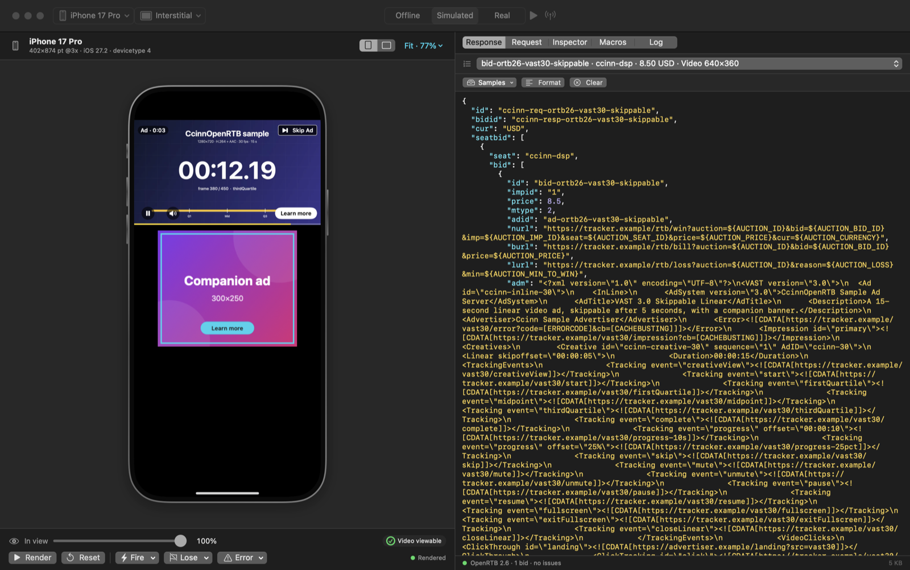
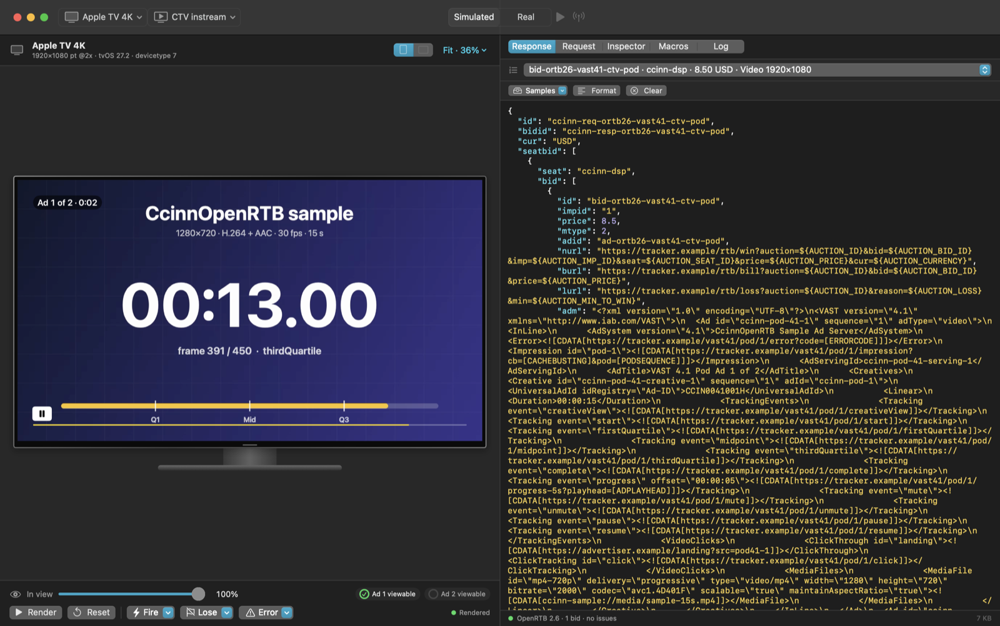
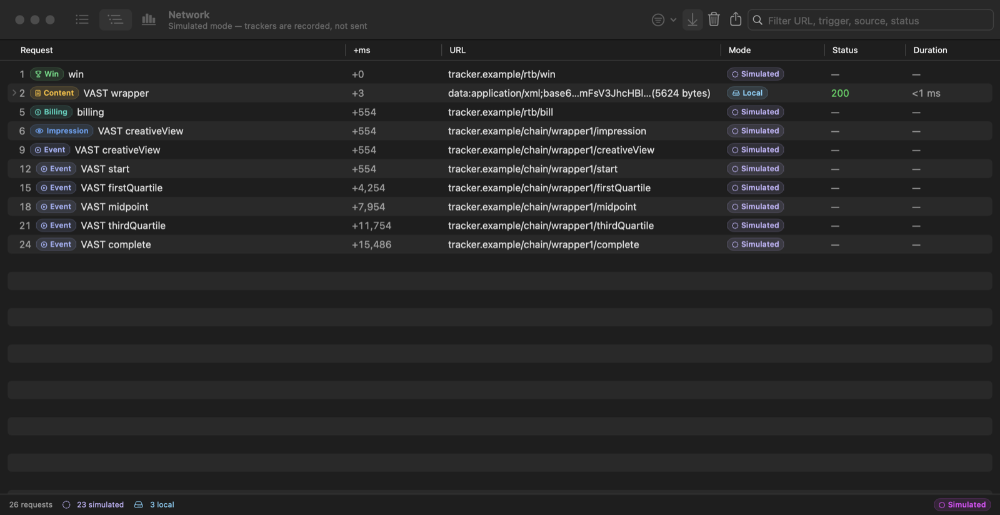

<p align="center">
  
</p>

<h1 align="center">CcinnOpenRTB</h1>

<p align="center">
  <b>原生 macOS OpenRTB 广告渲染与监测模拟器。</b><br>
  粘贴一份竞价响应，即可在模拟的手机、折叠屏、平板或电视上看到广告，并在实时网络视图中看到每一个监测请求。除非你明确要求，否则不会发出任何监测请求。
</p>

<p align="center">
  <a href="https://github.com/whiteCcinn/ccinnopenrtb/actions/workflows/ci.yml"></a>
  <a href="https://github.com/whiteCcinn/ccinnopenrtb/releases/latest"></a>
  
  
  
  
  <a href="LICENSE"></a>
</p>

<p align="center">
  <a href="README.md">English</a> · 简体中文
</p>

<p align="center">
  
</p>
<p align="center">
  
  
</p>

## 为什么选择 CcinnOpenRTB？

Exchange、SSP、DSP 和 SDK 工程师总在反复回答同一个问题：*这份竞价响应在设备上到底会渲染成什么样？会触发哪些监测请求？顺序是什么？* 要回答它，通常只能：

- 手工阅读 `adm` 里的内容；
- 把 VAST 粘贴到对 OpenRTB 一无所知的网页校验器里；
- 构建一个真实的 SDK，再把它接到测试 Exchange 上。

CcinnOpenRTB 让你在自己的 Mac 上就能得到答案。粘贴一份 OpenRTB 竞价响应、一段裸 `adm` 或一个 VAST 标签 URL，广告就会像 SDK 或播放器那样渲染在设备框中。每一次竞价成功通知、曝光、可见性事件、VAST 事件、点击和错误都会出现在 Network 窗口中，并带有展开后的宏、时间信息以及触发它的事件。

默认情况下不会发出任何监测请求，离线模式下则什么都不加载，详见[离线、模拟与真实模式](#离线模拟与真实模式)。这是一个原生 SwiftUI/AppKit 应用，没有第三方依赖，不捆绑运行时，也不收集任何数据。

## 离线、模拟与真实模式

每个会话都从**模拟模式**（Simulated）开始。**模拟模式永远不会发出监测请求或通知；但它会从广告素材中的 URL 加载广告内容（VAST、图片、视频），广告服务器能够看到这些请求。选择离线模式（Offline）则什么都不加载。**监测请求永不发出这一点由代码结构本身保证，而不仅仅依靠测试：HTTP 传输层只能凭“发送许可”调用，而模拟模式和离线模式下的监测请求根本拿不到这种许可。只有当你确实希望监测请求到达其服务器时，才切换到**真实模式**（Real）。

工具栏显示 **Offline · Simulated · Real**，每一段的提示文字都会说明该模式会加载什么、发出什么。Simulator 菜单中也有同样的选择。窗口会记住离线模式，但永远不会记住真实模式。

| | 离线 | 模拟（默认） | 真实 |
|---|---|---|---|
| **监测请求与通知**：竞价成功 `nurl`、计费 `burl`、竞价失败 `lurl`、曝光、可见性、VAST 事件、点击、错误 | 仅记录，**永不发出** | 仅记录，**永不发出** | 使用模拟设备的 User-Agent 发出，并记录状态码、耗时、实际发出的请求头与大小。 |
| **监测请求的重定向** | 不发出任何请求，因此不存在重定向 | 不发出任何请求，因此不存在重定向 | 不会自动跟随。由应用逐跳跟随，每一跳都记录为子条目（最多 10 跳，并检测循环）。 |
| **脚本类监测**：Native `jstracker`、method 为 2 的 `eventtrackers` 与 AdCOM 事件 | 仅记录，不运行 | 仅记录，不运行 | 记录后在各自独立的隐藏 Web 视图中各运行一次；它发起的加载记为它的子条目 |
| **HTML 创意自身的网络请求**：脚本、像素、`fetch`、XHR、beacon | 拦截 | 由 WebKit 内容规则列表拦截，无法解除。通过元素（`img`、`script`、`iframe`、`link`、媒体、`object`、`embed`）、`fetch`、XHR、`sendBeacon`、WebSocket 与 WebRTC 发起的加载显示为 `blocked`；来自 CSS（`url()`、字体、`@import`）、`EventSource`、`<a ping>` 与 Worker 的加载同样被拦截，但不产生条目。 | 不拦截 |
| **广告内容**：VAST 标签与 Wrapper 请求、图片、媒体文件、Native `assetsurl`、按引用提供的素材（AdCOM `display.curl`） | **不加载**。记录为 `offline`，广告位上会说明缺少什么 | 从素材中的 URL 加载 | 从素材中的 URL 加载 |
| **由竞价成功通知返回的广告素材**（有 `nurl` 但没有 `adm` 的出价） | 不请求 | 不请求：竞价成功通知本身是监测请求。广告位上会说明原因，切换到真实模式后才会请求 | 使用 `nurl` 的响应体作为广告素材，素材中的 URL 都挂在该请求之下 |
| **`data:` URL 与内置示例媒体**（`ccinn-sample://`） | 在本机解码或生成 | 在本机解码或生成 | 在本机解码或生成 |
| **点击跳转** | 记录为导航，永不打开 | 记录为导航，永不打开 | 记录；只有在开启 **Settings ▸ Network ▸ Open click-throughs in browser in Real mode** 时（默认关闭）才会打开，并且使用默认 Web 浏览器——即打开网页链接的那个应用，绝不会交给声明了该链接的其他应用。 |
| **你在 [Client](#client-标签页) 标签页中发送的竞价请求** | 记录为 `offline`，**不发出** | 按你输入的内容发往你填写的 URL | 按你输入的内容发往你填写的 URL |

- 切换到真实模式时会弹出确认框。它列出所选出价的监测请求主机名，说明哪些请求无法事先列出（脚本类监测、创意自身的脚本），列出本次渲染已经访问过的内容主机，并在本会话中已经发出过同一次竞价的竞价成功、计费或竞价失败通知时给出警告：再次发送可能导致 DSP 重复计数。取消则保持当前模式。
- 该确认只对当前会话有效，并且只针对确定的一个出价、设备与广告位：确认框显示期间只要其中任何一项发生变化，就会重新询问。
- 离开真实模式、重新渲染、**Reset** 和 **Lose** 都会立即生效：正在进行的监测请求会被取消（已在传输中的那一跳记为已取消，尚未发出的记为未发送），所有真实模式下的 Web 视图（脚本类监测、HTML 或 iframe 伴随广告）都会停止，仍在真实模式下准备中的渲染也会停止，因此之后的 Wrapper 请求不会带着真实模式的取值发出。
- 再次渲染同一个出价就是重放它的竞价：第一次之后的每一次播放都会在生命周期日志以及它引起的每条 Network 记录的来源中编号为 **replay N**（`bid 1.1 · replay 2 › nurl`）。在真实模式下，重放会再次发出该竞价的通知。
- **在你确认进入真实模式之前，粘贴的竞价请求中的个人数据不会离开你的 Mac。** 在模拟模式和离线模式下，任何由它派生的数据都不会离开本机（你自己在 Client 标签页中发送的竞价请求会按你输入的内容发往你填写的 URL；离线模式下不发出任何请求）：播放器请求 VAST 标签或 Wrapper 时，`[IFA]`、`[IFATYPE]`、`[DEVICEIP]`、`[LATLONG]`、`[GDPRCONSENT]`、`[GPPSTRING]` 与 `[GPPSECTIONID]` 一律以 `-1` 发出，`[DEVICEUA]` 则使用模拟设备的 User-Agent。描述发布方环境的宏（`[LIMITADTRACKING]`、`[DOMAIN]`、`[PAGEURL]`、`[APPBUNDLE]`、`[TRANSACTIONID]`）仍会用竞价请求中的值填充：它们描述的是广告位，而不是用户。真实模式会像真实设备一样，用粘贴的竞价请求中的值填充所有宏，包括设备标识符、位置与同意字符串；请只在测试请求或已获同意的情况下使用。
- 每个监测请求与内容请求都带有模拟设备的 User-Agent 和显式的 `Accept-Language`，不带 Cookie 和凭据；身份验证质询一律拒绝。视频和音频由应用自己请求，绝不经由媒体播放器自身的网络功能。
- 当前模式显示在工具栏上，也显示在 Network 窗口的每一条记录上。
- CTV 设备在任何模式下都不会跳转。
- Native 1.2 的 `dcourl`（动态创意，规范中仍为 beta）只会被记录为不支持，永远不会被请求。
- 除上述请求外，唯一会离开你的 Mac 的只有每天一次、向 GitHub 发起的更新检查，并且可以关闭。
- Client 标签页发出的竞价请求不是监测请求：离开真实模式、重新渲染、**Reset** 和 **Lose** 都不会取消它；切换到离线模式以及在 Network 窗口中 **Clear** 会取消它。

> [!WARNING]
> 真实模式发出的是真实的监测请求。对接收方服务器而言，它们看起来就像来自所模拟设备的流量，因此可能会抬高线上广告活动的数据。请只对自己的测试端点使用真实模式，或事先征得监测链接所有者的同意。

## 功能特性

- **像 Postman 一样发送竞价请求**：[Client](#client-标签页) 标签页把你输入的请求发往一个端点，展示响应，并按请求与响应所对应的格式和广告位在设备上渲染。可以把请求连同响应一起保存，日后再打开。
- **粘贴 Exchange 返回的任何内容**：OpenRTB 2.x 或 3.0 竞价响应、裸 `adm`（HTML、Native JSON 或 VAST XML），或 VAST 标签 URL。输入类型与版本会被自动识别。解析是宽松的：类型错误会成为校验问题，未知字段会被保留。无出价响应会显示 "No bid"，并给出 `nbr` 原因。
- **也模拟 Exchange 的那一部分**：和 Exchange 一样（OpenRTB 2.6 §4.4），模拟器会在设备拿到出价的内嵌 `adm`（HTML、Native JSON 或 VAST XML）之前，替换其中的 `${AUCTION_*}` / `${OPENRTB_*}` 宏；VAST 的 `[MACROS]` 留给播放器，在每个监测请求触发时才填充。DSP 在竞价成功后返回的素材（`nurl` 响应、`display.curl`）按原样使用。
- **选择出价**：列出所有 seat 下的全部出价及其格式。也可以同时粘贴竞价请求，用来解析 Native 资源类型、曝光位尺寸与广告位，以及请求侧的宏。出价对应的曝光位决定广告单元：`imp.rwdd`（或 `imp.ext.is_rewarded_inventory`、`imp.ext.prebid.is_rewarded_inventory`；AdCOM `placement.reward`）表示激励，`imp.instl` 或 `video.plcmt` 为 3（AdCOM `display.instl`）表示插屏。
- **像设备一样渲染**
  - HTML 与富媒体运行在带 MRAID 3.0 桥接的沙盒 Web 视图中。桥接调用都会被记录；点击和导航只会被记录，不会离开模拟器。
  - 图片横幅（OpenRTB 3.0 `display.banner`）。
  - Native 1.0、1.1、1.2，提供信息流、内容流和应用安装三种布局，支持隐私链接与按资源的点击。
  - VAST 视频与音频：跳过（来自 `skipoffset`）、静音、暂停、倒计时、点击跳转、进度条、伴随广告（从该广告的第一帧起展示）或结束卡片、AdChoices 等行业图标、按 `sequence` 顺序播放的 Ad Pod，以及最多 5 层的 Wrapper 链。必需的伴随广告（`CompanionAds@required`）无法展示时（CTV 上一个都无法展示），该广告不会播放（错误 602）；Wrapper 的 `BlockedAdCategories` 会拒绝类别匹配的广告（错误 205）。
  - 广告位：内嵌横幅、信息流、插屏、激励视频，以及 CTV 贴片（instream）。出价会自动选择合适的广告位（优先采用竞价请求中的激励或插屏曝光位，其次 320×480 的出价为插屏、Native 为信息流、视频为全屏；CTV 设备为贴片），也可以手动更改。全屏广告带有关闭按钮，点击区域在 Apple 设备上至少 44 pt、在 Android 设备上至少 50 pt；不可跳过的视频在播放结束后才提供关闭按钮。
  - CTV：全屏播放 Ad Pod（"Ad 1 of 2"），用方向键、Return、Escape 和空格进行遥控器式焦点操作，不支持点击跳转。
- **设备**：共 28 款（默认 iPhone 18 Pro）：从 SE 到 18 Pro Max 的 iPhone、Android 手机、包括 iPhone Duo 在内的折叠屏（折叠或展开）、Surface Duo（单屏或跨越铰链）、iPad，以及四个 CTV 平台，支持竖屏和横屏，每款设备都有各自的系统界面与模拟应用。详见[设备](#设备)。
- **在正确的时机触发监测**：监测请求会在真实 SDK 或播放器触发它的时刻触发，OpenRTB、AdCOM 与 VAST 宏都会被展开，未知的宏会被报告。**Viewability** 滑块可以把广告滚入或滚出视野，并据此执行 MRC 规则：展示类广告 50% 可见持续 1 秒，视频广告 50% 可见持续 2 秒。**Fire** 按钮可以手动触发事件。详见[监测与宏](#监测与宏)。
- **Network 窗口**：以表格、关系树和瀑布图实时展示每一个请求，提供详情、筛选、HAR 导出和复制为 curl。详见 [Network 窗口](#network-窗口)。
- **规范校验**：检查器会按识别出的 OpenRTB、Native 和 VAST 版本检查响应：必填字段、类型错误、无效 URL、竞价请求要求安全创意时的非 HTTPS 监测链接、缺少可播放的媒体文件、Wrapper 层数，以及属于其他版本的字段。每个问题都有严重级别、代码、说明和位置（JSON 指针或 VAST 元素路径）。
- **离线可用的示例**：内置示例覆盖所有支持的格式和版本：HTML 与 MRAID、Native 1.0–1.2、VAST 2.0–4.2（包括 Wrapper 链、CTV Ad Pod 和音频广告）、OpenRTB 3.0，以及无出价响应。示例媒体在首次使用时于本机生成，并缓存在 `~/Library/Caches` 下：一段带时间码的 15 秒 1280×720 H.264 MP4、一段 15 秒 AAC 提示音，以及若干 PNG 图片。

## Client 标签页

每个窗口右侧面板中的请求编辑器，用来向 Exchange、SSP 或 DSP 的端点发送竞价请求，并在设备上查看返回的结果。

- **编写**：方法（**POST**；端点通过 URL 接收查询时用 **GET**）、端点 URL、请求头，以及你输入的请求体。新请求默认带有 `Content-Type: application/json` 与 `x-openrtb-version: 2.6`；可以停用、修改这些请求头或添加自己的请求头。**Format**（⇧⌘F）只格式化请求体，不改变键的顺序。
- **发送**（⌘↩）：经由该窗口的网络关口发出，带有模拟设备的 User-Agent（除非另选设备，否则为 iPhone 18 Pro）和显式的 `Accept-Language`，除非你自己设置了这些请求头。**Cancel**（⌘.）可以中止。无法发送的请求会说明原因：URL 不是 http(s)、请求头名称不是合法 token、取值中含有换行、同一请求头设置了两次。请求体不是 JSON 时仍按原样发送，并给出警告。
- **响应**：状态码、耗时、大小、响应头，以及响应体（JSON 会被格式化）。任何状态码都会展示，包括错误响应的响应体。
- **在设备上展示**：带响应体的 2xx 响应会填入 **Response** 编辑器，请求填入 **Request** 编辑器，因此模拟器会根据两者确定出价格式（`mtype`、曝光位的媒体类型、素材本身），并根据请求确定广告位（激励、插屏、信息流……）。模拟模式与离线模式下会立即渲染；真实模式下只填入编辑器，设备等待你点击 **Render**，因为渲染会发出该出价的监测请求。204 或空响应体表示无出价，模拟器保持不变。标签页会显示模拟器的识别结果，例如 "OpenRTB 2.6 · 1 bid · Video · Rewarded · iPhone 18 Pro"。
- **保存的请求**：**Save**（⌘S）会保存请求及其最近一次响应和发送时使用的设备；**Saved** 在每个窗口中列出它们（最新的在前，可搜索）。打开后可以再次发送，或者在其设备上 **Render** 保存的响应而不发出任何请求。可以在列表中复制或删除。每个请求是 `~/Library/Application Support/CcinnOpenRTB/Requests/` 下的一个 JSON 文件，只有你的账户可以读取；其中包含你的请求头（包括凭据）以及请求中的个人数据。
- **迁移到另一台 Mac**：**Export All…**（在 **Saved** 中，或 ⋯ 菜单中）会把所有保存的请求及其最近一次响应写入一个 JSON 文件；在另一台 Mac 上用 **Import…** 一次导入全部内容。按 id 合并：只有更新的副本才会替换已有的请求，因此重复导入不会改变任何内容。损坏的条目会被跳过并计数，绝不会导致失败。导出文件包含你的请求头（包括凭据）以及请求中的个人数据，写入后只有你的账户可以读取：请妥善保管。
- **Copy as curl**（⋯ 菜单中）复制的正是 Send 会发出的内容（请求设置为跟随所有重定向时带有 `--location --max-redirs 10`）。
- **重定向**：每个请求都有自己的设置，位于 **Body** 与 **Headers** 旁边（新请求的默认值在 Settings ▸ Network ▸ Client 中设置）：
  - **Follow redirects within the origin**（默认）：跟随端点同一协议、主机与端口内的重定向；跳到其他地方（其他主机、协议或端口，包括 http↔https）的重定向就是响应，因此你输入的任何内容——例如 `X-Api-Key` 这类自定义凭据、请求中的个人数据——都不会发往你没有指定的地址。**Follow to ‹host› and Send** 按钮会以“跟随所有重定向”的方式重新发送同一个请求，仅对这一次发送生效（请求本身的设置不变），并直接打开链路视图；只有在请求未被修改、且继续跟随能走得更远时才会出现。
  - **Follow all redirects**：与 `curl -L` 一样跟随每一跳，最多 10 跳，并检测循环。跳到其他源时不携带 `Authorization`、`Proxy-Authorization` 与 `Cookie`；你的其他请求头，以及 307、308 时的 POST 与请求体会一并发出。降级到 http 的跳转会被跟随并标出。
  - **Don't follow redirects**：第一个 3xx 就是响应。

  每一跳中，307 与 308 会重复方法与请求体；303（以及 POST 之后的 301 或 302）改为不带请求体的 GET。
- **重定向链路**：响应的 **Redirects** 标签页按顺序列出链路中的每个请求：方法、URL、状态码、指向的 `Location`、耗时、携带的请求体、途中的变化（方法、请求体、未携带的请求头、降级到 http），以及链路结束的原因（未跟随、循环、超过 10 跳）。循环、跳数过多或目标不是 http(s) 都是可以检查的响应，而不是错误。该请求在 Network 窗口中是一条 **Bid request** 记录，每一跳都是带有相同说明的子条目。

## Network 窗口

通过 **Window ▸ Network**（**⌥⌘N**）打开。Network 窗口只有一个，它显示当前处于焦点的主窗口的会话。

- **列表（List）**，实时更新：序号、相对时间（+ms）、类别、触发原因、主机与路径、模式、状态码与耗时。
- **关系树**：一个请求的父请求，是交付了“包含其 URL 的文档”的那个请求。每个 VAST 监测、媒体文件和伴随广告（其图片、HTML 或 iframe 伴随广告自身的加载与导航）都挂在交付它的 Wrapper 或 Inline 那一跳之下；由 `nurl` 或 `display.curl` 交付的素材中的监测、点击、导航和创意加载都挂在该请求之下；直接写在竞价响应中的 URL（`nurl`、`burl`、`lurl`、AdCOM 事件、AdCOM 横幅链接）没有父请求。重定向的每一跳挂在其监测请求之下。监测请求永远不会成为导航的父请求：同一次点击产生的请求共享同一个触发原因。
- **瀑布图**时间线。
- **详情**：URL 模板与展开后的 URL 并排显示并高亮宏，列出已替换和未知的宏、查询参数、请求头与响应头、重定向链，以及内容请求的响应预览。
- **筛选**：按类别、模式和文本筛选。**Follow tail** 让最新的记录始终可见，**Clear** 清空当前会话的列表。
- **内容**类记录带有 CONTENT 标记，因此应用为渲染广告而加载的内容不会被误认为监测请求。VAST 标签或 Wrapper 的 URL 会把书写时的 URI 与实际请求的 URL 并排显示（播放器会展开其中的 VAST 宏）。请求头是实际发出的请求头。
- **导出 HAR 1.2**：每条记录带有自定义的 `_ccinn` 字段：`sequence`、`category`、`trigger`、`source`、`mode`、`delivery`、`parent`、`template` 和 `macros`。竞价请求的请求体导出为 `postData`。
- **Copy URL** 与 **Copy as curl**：curl 命令经过 shell 转义并使用 `--globoff`，因此 VAST 的 `[MACROS]` 不会被 curl 当作通配模式。竞价请求的请求体放在 `--data-raw` 中并保留换行（绝不使用 `--data-binary` 或 `-d`，它们会把以 `@` 开头的请求体当作要上传的文件）；其他控制字符写成 JSON 的 `\u00XX` 转义。
- 每个会话最多保留 10,000 条记录，超出时最早的记录会被丢弃。

| 类别 | 含义 |
|---|---|
| `win` | 竞价成功通知：`nurl`（2.x）或 `purl`（3.0） |
| `billing` | 计费通知：`burl` |
| `loss` | 竞价失败通知：`lurl` |
| `impression` | VAST `Impression`、Native `imptrackers` 与曝光类事件监测、AdCOM 曝光事件 |
| `viewability` | Native `eventtrackers` 2–4、AdCOM 事件 3–5、VAST `ViewableImpression` |
| `event` | VAST 监测事件：`creativeView`、`start`、四分位、`complete`、`progress`、`mute`、`pause`、`skip` 等 |
| `click` | Native `clicktrackers`、VAST `ClickTracking` 与 `CompanionClickTracking` |
| `navigation` | 点击跳转目标：Native `link.url`、VAST `ClickThrough`、`mraid.open`、`window.open`、链接 |
| `error` | 带 `[ERRORCODE]` 的 VAST `Error` URL |
| `verification` | VAST `AdVerifications` 的监测，例如 `verificationNotExecuted` |
| `content` | 应用为渲染广告而请求的内容：VAST Wrapper 与标签、图片、媒体文件、Native `assetsurl`、`display.curl` 素材 |
| `creative` | HTML 创意自己加载或尝试加载的一切 |
| `bidRequest` | 你在 Client 标签页中发送的竞价请求，包括方法、请求头与请求体 |

HAR 导出中，模式记录在 `_ccinn.delivery`：`simulated`、`network`（即 Sent）、`blocked`、`offline`、`local`、`renderer` 或 `browser`；`_ccinn.mode` 是会话的监测模式。

| 模式 | 含义 |
|---|---|
| Simulated | 仅记录，未发出 |
| Sent | 由应用发出：真实模式下的监测请求，或内容请求 |
| Blocked | 创意尝试加载，被沙盒拦截 |
| Offline | 会话处于离线模式，因此没有加载的内容 |
| Local | 在本机提供：`data:` URL 或内置示例媒体 |
| Renderer | 由 Web 视图自身加载：真实模式下创意自身的加载、注入的脚本类监测 |
| Browser | 在默认浏览器中打开的点击跳转 |

## 监测与宏

| 时机 | 触发的内容 |
|---|---|
| 竞价成功 | `nurl`（2.x）或 `purl`（3.0） |
| 渲染 | `burl`、AdCOM 事件类型 1（loaded）与 2（impression）、Native `imptrackers` 以及事件为 1 的 `eventtrackers`。Native 广告在图标与主图加载完成或失败后触发（最迟在广告显示后 1 秒）。VAST 广告在第一个真正开始播放的广告的第一帧时触发 |
| 每个 VAST 广告的第一帧 | 该广告 Wrapper 链中每个文档的 `Impression` URL、它的 `creativeView` 监测，以及其验证资源的 `verificationNotExecuted` |
| 可见 | Native `eventtrackers` 2–4、AdCOM 事件 3–5 与 VAST `ViewableImpression`，在满足 MRC 规则时触发（展示类：50% 可见持续 1 秒；视频：50% 可见持续 2 秒） |
| 播放 | `start`、`firstQuartile`、`midpoint`、`thirdQuartile`、`complete`、`mute`、`unmute`、`pause`、`resume`、`skip`、`fullscreen`、`close` 等，每个广告各触发一次；`progress` 每个时间点触发一次 |
| 伴随广告展示 | 该伴随广告的 `creativeView`（在其广告的曝光之后），并先触发相匹配的 Wrapper 伴随广告监测 |
| 图标展示 / 点击 | 图标图片显示在屏幕上后触发 `IconViewTracking`；点击时触发 `IconClickTracking`，随后把 `IconClickThrough` 记录为导航 |
| 点击 | Native `clicktrackers`（优先使用资源自身的链接）、VAST `ClickTracking` 或 `CompanionClickTracking`；随后把点击跳转记录为导航 |
| 竞价失败 | `lurl`，其 `${AUCTION_LOSS}` 为你选择的原因（获胜出价的所有 URL 都为 0，即 "Bid Won"）。未被选中的出价不会自动收到竞价失败通知 |
| 错误 | 带 `[ERRORCODE]` 的 VAST `Error` URL，例如 Wrapper 链最终没有广告时为 303，没有可播放的媒体文件时为 403（只有 VPAID 媒体的广告也是如此），广告类别被屏蔽时为 205，必需的伴随广告无法展示时为 602 |

| 类型 | 宏 |
|---|---|
| OpenRTB | `${AUCTION_ID}`、`${AUCTION_BID_ID}`、`${AUCTION_IMP_ID}`、`${AUCTION_SEAT_ID}`、`${AUCTION_AD_ID}`、`${AUCTION_PRICE}`、`${AUCTION_CURRENCY}`、`${AUCTION_MBR}`、`${AUCTION_LOSS}`、`${AUCTION_MIN_TO_WIN}`，以及它们的 `:B64` 变体（base64url） |
| OpenRTB 3.0 | `${OPENRTB_ID}`、`${OPENRTB_BID_ID}`、`${OPENRTB_ITEM_ID}`、`${OPENRTB_SEAT_ID}`、`${OPENRTB_MEDIA_ID}`、`${OPENRTB_PRICE}`、`${OPENRTB_CURRENCY}`、`${OPENRTB_LOSS}`、`${OPENRTB_MIN_TO_WIN}` 等；出价的 `bid.macro` 键写作 `${CUSTOM_KEY}` |
| Exchange | 裸的 `${KEY}` 是你在 Macros 面板中定义的宏 |
| VAST 4.x | `[ERRORCODE]`、`[TIMESTAMP]`、`[CACHEBUSTING]`、`[ADPLAYHEAD]`、`[CONTENTPLAYHEAD]`、`[ASSETURI]`、`[PLAYERSIZE]`、`[PODSEQUENCE]`、`[ADSERVINGID]`、`[UNIVERSALADID]`、`[DEVICEUA]`、`[IFA]`、`[REASON]` 等（取值经过 URL 编码；列表类宏逐项编码并保留字面逗号；已知但没有取值的宏为 `-1`） |

- **谁替换什么。** Exchange 的 `${…}` 宏只在 Exchange 会替换的地方被替换：竞价响应中的内联 `adm`、`nurl`、`burl`、`lurl`、OpenRTB 3.0 的 `purl`、AdCOM `display.event` 以及横幅链接。VAST 的 `[…]` 宏只由播放器替换，并且只在 VAST URL 中替换（监测 URL 以及 VAST 标签和 `VASTAdTagURI` 的请求 URI 都是如此）。之后才获取的文档——`nurl` 的响应、`display.curl` 素材、Wrapper 的响应、粘贴的 VAST 标签——其中的 `${…}` 会原样保留，检查器会给出警告：这些宏本应由 DSP 的服务器填好。Native 监测按原样发出。
- `[ASSETURI]` 是播放器选中的媒体文件，`[BREAKPOSITION]` 在 CTV 插播中为 1（前贴片），其他情况为 4（独立展示），`[ADCOUNT]` 是将要播放的广告数，`[TIMESTAMP]` 使用设备的时区，否则使用 UTC。
- 未知的宏会原样保留，并在检查器和该记录的详情中报告。
- 宏的取值可以编辑：成交价（默认为出价）、加密价格（一个不透明字符串，原样替换 `${AUCTION_PRICE}`）、竞价 ID、竞价失败原因以及自定义宏。

## 兼容性

| 规范 | 版本 | 说明 |
|---|---|---|
| OpenRTB | 2.0 – 2.6 | 版本通过字段推断：存在 `mtype` 或其他 2.6 字段时为 2.6，存在 `burl` 或 `lurl` 时为 2.5，否则为 2.x。 |
| OpenRTB + AdCOM | 3.0 + AdCOM 1.0 | `display`（`adm`、`banner`、`native`、`event`）、`video` 与 `audio`（`adm`、`curl`）、`bid.macro`。 |
| OpenRTB Native | 1.0、1.1、1.2 | 支持带外层 `{"native": …}` 与不带外层两种形式。没有竞价请求时，1.0/1.1 的 data 资源类型会被推断，并标记为 "inferred"。 |
| VAST | 2.0、3.0、4.0、4.1、4.2 | 最多 5 层 Wrapper、Ad Pod、带 `required` 的伴随广告、行业图标（图片 `StaticResource`）、`BlockedAdCategories`。永远不会选择 VPAID 媒体：只有 VPAID 媒体的广告报告错误 403。SIMID 与 OMID 验证脚本只列出，不执行。`allowMultipleAds="false"` 的 Wrapper 收到 Ad Pod 时，会播放该 Pod 的第一个广告并在检查器中给出警告；更严格的播放器会把这种情况视为没有广告（错误 303）。 |
| MRAID | 3.0 | 注入到 HTML 创意中的兼容层，每一次桥接调用都会被记录。 |

CcinnOpenRTB 支持 **macOS 14 Sonoma 及以上**（Apple 芯片与 Intel）。

### 设备

| 类别 | 设备 |
|---|---|
| iPhone | iPhone SE（第 3 代）、13 mini、15、15 Plus、15 Pro、15 Pro Max、16 Pro、16 Pro Max、16e、17、Air、17 Pro、17 Pro Max、18 Pro、18 Pro Max（刘海、灵动岛或 Home 键，各有各的安全区） |
| Android 手机 | Pixel 8、Galaxy S24 |
| 折叠屏 | iPhone Duo（展开 951×669 pt，折叠后为 iPhone 式外屏）、Galaxy Z Fold5、Pixel Fold，可折叠或展开 |
| 双屏 | Surface Duo：单屏，或跨越 34 pt 的铰链 |
| 平板 | iPad（第 10 代）、iPad Pro 11"（第 4 代）、iPad Pro 11"（M5） |
| CTV | Apple TV 4K、Google TV（4K 电视）、Fire TV Stick 4K Max（第 2 代）、Roku Express（1080p）：1920×1080 pt，遥控器操作，不支持点击跳转 |

每台设备都带有 OpenRTB `devicetype`、操作系统及版本（iOS / iPadOS / tvOS 27.2，Android 17——Surface Duo 停留在 12——，Android TV 14，Fire OS 8.1.8.5，Roku OS 15.3）、其应用内 Web 视图的 User-Agent（iPad 使用其 Web 视图发出的桌面级 User-Agent）和屏幕几何信息（尺寸、缩放倍率、圆角、安全区、刘海/开孔、铰链或折叠后的屏幕）。这些信息用于渲染、选择 VAST 媒体文件、展开 `[DEVICEUA]` 等宏，并作为真实模式下监测请求以及 Client 标签页所发竞价请求的 User-Agent。CTV 只支持横屏。新窗口默认使用 iPhone 18 Pro。

## 安装

1. 从 [最新 Release](https://github.com/whiteCcinn/ccinnopenrtb/releases/latest) 下载 `CcinnOpenRTB-<版本>.dmg`（或 `.zip`）。
2. 打开磁盘映像，把 **CcinnOpenRTB** 拖入 **应用程序**。
3. 应用使用 ad-hoc 签名，未经过 Apple 公证。首次打开时请右键点击应用并选择**打开**，或执行：

   ```bash
   xattr -dr com.apple.quarantine /Applications/CcinnOpenRTB.app
   ```

每个 Release 都附带 `SHA256SUMS.txt` 校验和。

### 更新

选择 **CcinnOpenRTB ▸ Check for Updates…（检查更新…）**。如果有新版本，CcinnOpenRTB 会显示更新内容。**Download & Open（下载并打开）** 会把磁盘映像保存到“下载”文件夹，按该版本的 `SHA256SUMS.txt` 校验后再打开。退出 CcinnOpenRTB，然后把新版本拖到 **应用程序** 文件夹即可。

CcinnOpenRTB 每天也会在后台自动检查一次，可以在 **Settings ▸ General** 中关闭。检查只访问 GitHub 的公开 Releases API，也可以选择 **Skip This Version（跳过此版本）**。

项目主页、发布说明和问题反馈入口也在 **Help** 菜单、“关于”窗口和 **Settings ▸ General** 中。

## 快速开始

1. 选择一个内置示例，或在右侧的 **Response** 编辑器中粘贴 OpenRTB 竞价响应、裸 `adm` 或 VAST 标签 URL。
2. 选择设备、方向和广告位，左侧的模拟器会渲染所选出价。
3. 按 **⌥⌘N** 打开 Network 窗口，观察监测请求的触发。拖动 **Viewability** 滑块，或使用 **Fire** 按钮，触发更多事件。
4. 可选：在 **Request** 中粘贴竞价请求，选择其他 seat 或出价，设置成交价或其他宏的取值。

也可以从请求开始：打开 **Client** 标签页，填写端点和竞价请求，然后按 **⌘↩**。响应会显示在设备上。

| 快捷键 | 作用 |
|---|---|
| **⌘↩** | 发送请求（Client 标签页） |
| **⌘S** | 保存请求及其响应（Client 标签页） |
| **⌥⌘N** | Network 窗口 |
| **⌘K** | 清空 Network 窗口的列表 |
| **⌘,** | 设置 |

更多快捷键请查看菜单。

## 设置

- **General（通用）**
  - 外观。
  - 自动检查更新，以及 **Check Now（立即检查）**。
  - 版本号与项目链接。
- **Network（网络）**
  - 每个会话都从模拟模式开始（如果其窗口处于离线模式，则从离线模式开始）。这是有意不做成设置项的：真实模式只能按会话开启，并且需要确认。
  - **Request timeout（请求超时）**：5、10、15、30 或 60 秒，默认 15 秒。
  - **Open click-throughs in browser in Real mode（真实模式下在浏览器中打开点击跳转）**：默认关闭。关闭时，点击跳转只会被记录。

## 从源码构建

环境要求：macOS 14+，Xcode 16 或更高版本（Swift 6）。

```bash
git clone https://github.com/whiteCcinn/ccinnopenrtb.git && cd ccinnopenrtb
swift build                          # Debug 构建
swift test                           # 单元测试、渲染器测试与端到端验收测试
scripts/build-app.sh --open          # 构建 dist/CcinnOpenRTB.app 并启动
scripts/package-release.sh 1.2.0     # 在 dist/ 中生成通用架构 .app、.zip、.dmg 与校验和
```

### 用于检查的启动参数

```bash
dist/CcinnOpenRTB.app/Contents/MacOS/CcinnOpenRTB --sample ortb26-vast42-verification --device iphone-17-pro \
  --snapshot /tmp/vast.png --export-har /tmp/vast.har --quit-after-snapshot
```

| 参数 | 作用 |
|---|---|
| `--sample <id>` | 加载一个内置示例（即 `SampleLibrary` 中的 id）并渲染。加上 `--no-render` 则只加载。 |
| `--device <id>`、`--landscape`、`--folded`、`--spanned` | 设备及其姿态。 |
| `--placement <名称>`、`--visibility <0…1>`、`--zoom fit\|<倍率>` | 广告位（`in-feed`、`interstitial` 等）、广告的可见比例、画布缩放。 |
| `--mode offline\|simulated\|real` | 会话的模式。`real` 只会弹出确认框：命令行永远不能自行开启真实模式。 |
| `--snapshot <file.png>` | 在 `--snapshot-delay <秒>`（默认 4）之后、窗口绘制完成时把主窗口渲染为 PNG，并绘入当前视频帧以及弹出的表单（例如真实模式确认框）。`--quit-after-snapshot` 会在之后退出，并取消尚未确认的确认框。 |
| `--export-har <file.har>` | 在截图之后写出该窗口的网络日志（HAR 1.2，`_ccinn` 中带有父子关系）。 |
| `--open-network` | 打开 Network 窗口。 |
| `--demo-network` | 用合成的记录填充 Network 窗口，无需渲染广告即可检查该窗口。 |
| `--snapshot-network <file.png>` | 将 Network 窗口渲染为 PNG（可配合 `--snapshot-delay <秒>`、`--quit-after-snapshot`），无需屏幕录制权限。 |
| `--network-layout list\|tree\|waterfall`、`--network-select <序号>` | 截图时使用的布局和选中的请求。 |
| `--no-update-check` | 跳过自动更新检查。 |

## 架构

```
CcinnOpenRTB（SwiftUI 应用：外壳、模拟器、渲染器、Network 窗口）
 └─ CcinnOpenRTBKit   网络监视器：模拟/真实分发、不自动重定向的 URLSession 传输层、HAR、curl；示例媒体；更新
     └─ RTBKit        仅依赖 Foundation：OpenRTB 2.x/3.0、Native、VAST 解析与 Wrapper 解析、宏、监测计划、设备、校验、示例
```

- **确定性的核心**：RTBKit 只依赖 Foundation，不做任何 I/O。解析、Wrapper 合并、宏展开和监测计划都是输入的纯函数，因此监测请求的顺序由单元测试覆盖。VAST Wrapper 的请求通过 `VASTFetcher` 协议完成，由应用基于网络监视器实现。
- **通往网络的唯一关口**：所有请求都经过同一个分发策略——监测请求、内容、媒体播放器的字节范围请求、HLS 播放列表与分片，以及你在 Client 标签页中发送的竞价请求都是如此。传输层只能凭发送许可调用；该策略不会为模拟模式或离线模式下的监测请求签发许可，离线时也不会为远程内容签发许可。切回模拟模式后，监测请求的重定向链会在下一跳之前停止。
- **每一跳都可见**：传输层每次只发送一个请求，从不跟随重定向。监视器记录每个 3xx 响应，并自行跟随。
- **输入永不导致崩溃**：类型错误和缺失字段会成为带位置信息的校验问题，未知字段会被保留。
- **并发安全**：项目在 Swift 6 严格并发模式下编译。网络更新会先合并再送到界面，大量监测请求同时到来也不会卡住窗口。

## ccinn 系列

同样注重设计、速度与细节的原生 macOS 工具：

| 应用 | 简介 |
|---|---|
| [**CcinnMongo**](https://github.com/whiteCcinn/ccinnmongo) | 原生 MongoDB 客户端，支持 2.6 到 8.x 的所有版本，同时支持旧版 `OP_QUERY` 与新版 `OP_MSG` 协议。 |
| [**CcinnStarRocks**](https://github.com/whiteCcinn/ccinnstarrocks) | 原生 StarRocks 客户端：分区、Tablet 与倾斜分析、物化视图、运行中任务，以及带补全和图表的 SQL。 |
| [**CcinnRedis**](https://github.com/whiteCcinn/ccinnredis) | 原生 Redis 客户端，支持 Redis 2.8 → 8.x 与 Valkey，覆盖单机、Sentinel、Cluster 与代理部署。 |
| [**CcinnBucket**](https://github.com/whiteCcinn/ccinnbucket) | 对象存储浏览器，支持 Amazon S3、S3 兼容服务与阿里云 OSS。 |
| [**CcinnMysql**](https://github.com/whiteCcinn/ccinnmysql) | 原生 MySQL、MariaDB 与 Percona 客户端，支持 5.5 → 9.x：TLS 与全部认证插件、InnoDB 锁、Top 语句、复制、可视化 EXPLAIN 与安全的行内编辑。 |
| [**CcinnPsql**](https://github.com/whiteCcinn/ccinnpsql) | 原生 PostgreSQL 客户端，支持 9.6 → 18：阻塞树、索引与膨胀分析、复制与复制槽、可视化 EXPLAIN ANALYZE，并识别 PgBouncer 与 Pgpool。 |
| [**CcinnClickHouse**](https://github.com/whiteCcinn/ccinnclickhouse) | 原生 ClickHouse 客户端，支持 22.8 → 26.x：引擎族、Part 与压缩、Merge、Mutation、复制、查询日志分析与集群拓扑。 |
| **CcinnOpenRTB** *（本项目）* | 原生 OpenRTB 广告渲染与监测模拟器：在模拟的手机、折叠屏、平板和电视上呈现 OpenRTB 2.x/3.0、Native 1.0–1.2 与 VAST 2.0–4.2 广告，并实时展示每一个监测请求。 |

## 贡献者

- [whiteCcinn](https://github.com/whiteCcinn)

<a href="https://github.com/whiteCcinn/ccinnopenrtb/graphs/contributors"></a>

## Star 趋势

[](https://star-history.com/#whiteCcinn/ccinnopenrtb&Date)

## 参与贡献

欢迎贡献！请先阅读 [CONTRIBUTING.md](CONTRIBUTING.md)；安全问题请按照 [SECURITY.md](SECURITY.md) 私下报告。

## 许可证

[MIT](LICENSE) © 2026 whiteCcinn。OpenRTB、AdCOM、Native 与 VAST 是 IAB Tech Lab 制定的规范；本项目与 IAB Tech Lab 无关，也未获得其背书。
